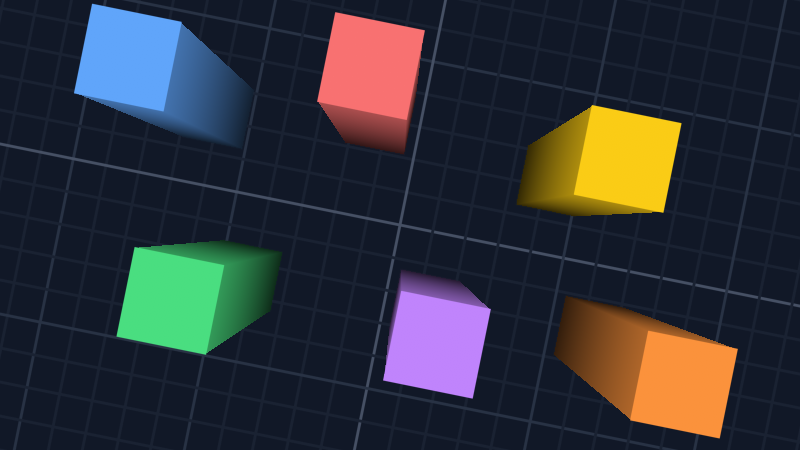

# 3D
This guide will show you how to draw 3D geometry that lines up with the 2D layers.

This guide builds on top of [Depth](../depth/README.md).

## View and projection

`GetView3D()` and `GetProjection3D()` give you a perspective view of the same world. A point at `(x, y)` on the layer at depth `z` is at `(x, y, z)` in 3D, so you can mix 2D layers with 3D geometry:

```csharp
_effect = new BasicEffect(GraphicsDevice) {
    VertexColorEnabled = true,
};
```

```csharp
_camera.SetViewport();

_effect.World = Matrix.Identity;
_effect.View = _camera.GetView3D();
_effect.Projection = _camera.GetProjection3D();

foreach (EffectPass pass in _effect.CurrentTechnique.Passes) {
    pass.Apply();
    GraphicsDevice.DrawUserPrimitives(PrimitiveType.TriangleList, _vertices, 0, _vertices.Length / 3);
}

_camera.ResetViewport();
```

The position, `Rotation`, `Scale` and `FocalLength` all apply to the 3D view. Here, the colored squares on top are drawn on the ground with `View` and the dark ones under them on a layer at -0.5 with `GetView(-0.5f)`. The walls in between are 3D triangles that go from a depth of 0 to -0.5:



The y axis points down like in 2D and z points toward the camera. A model made for a world where y points up comes out mirrored, which also flips which side of its triangles gets culled. You can use `RasterizerState.CullNone` if that's an issue.

## Near and far planes

`GetProjection3D` takes the distance of the near and far planes from the camera. They're at 0.01 and 100 by default. Geometry that's outside of that range doesn't get drawn:

```csharp
_effect.Projection = _camera.GetProjection3D(0.1f, 1000f);
```

`GetBoundingFrustum3D` takes the same distances and gives you the 3D frustum, for culling:

```csharp
BoundingFrustum frustum = _camera.GetBoundingFrustum3D();
if (frustum.Intersects(model.Bounds)) {
    // Draw the model.
}
```

## Orthographic projection

`GetProjection()` is the projection that goes with `GetView(z)`. It's useful for effects that take the view and the projection separately, like a `BasicEffect` that draws on one of the layers:

```csharp
_effect.View = _camera.GetView(-1f);
_effect.Projection = _camera.GetProjection();
```
