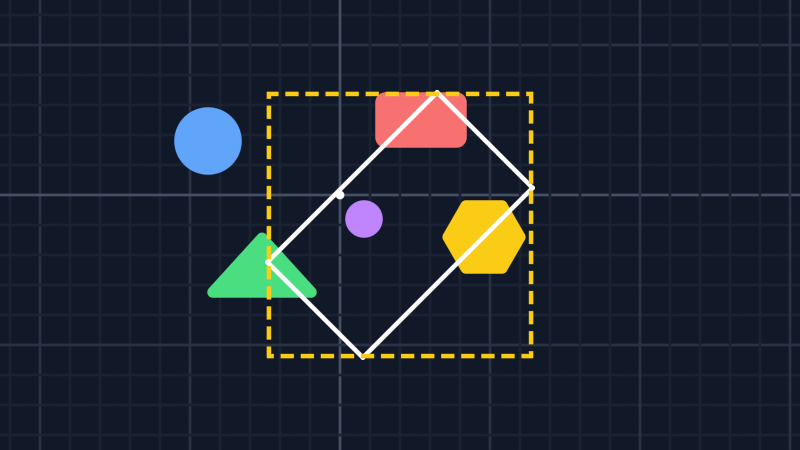

# Camera
This guide will show you how to go between screen and world coordinates and how to find what the camera sees.

## Screen and world

`ScreenToWorld` takes a point in window pixels and gives you the world point under it. `WorldToScreen` goes the other way. Both take the viewport's position on the window into account, so the mouse position goes in as is:

```csharp
MouseState mouse = Mouse.GetState();
Vector2 mouseWorld = _camera.ScreenToWorld(mouse.X, mouse.Y);
```

`WorldToScreen` gives window pixels too. While the viewport is set, drawing is relative to its top left corner, so subtract the viewport's position to draw something on top of a world point:

```csharp
Vector2 screen = _camera.WorldToScreen(_player.Position) - _camera.VirtualViewport.XY;

_camera.SetViewport();
_spriteBatch.Begin();
_spriteBatch.Draw(_marker, screen, Color.White);
_spriteBatch.End();
_camera.ResetViewport();
```

The marker stays the same size at any zoom and rotation.

## Dragging

Let's say you want to drag the world around with the middle mouse button. When the button goes down, remember the world point under the mouse. While it's held, move the camera so that this point stays under the mouse:

```csharp
MouseState mouse = Mouse.GetState();
Vector2 mouseWorld = _camera.ScreenToWorld(mouse.X, mouse.Y);

if (mouse.MiddleButton == ButtonState.Pressed) {
    if (!_isDragging) {
        _dragAnchor = mouseWorld;
        _isDragging = true;
    }
    _camera.XY += _dragAnchor - mouseWorld;
} else {
    _isDragging = false;
}
```

This works at any zoom and rotation since `ScreenToWorld` does the math.

## Zooming on the mouse

`Scale` zooms around the middle of the viewport. To zoom around the mouse instead, check which world point is under the mouse before and after the zoom, then move the camera by the difference:

```csharp
Vector2 before = _camera.ScreenToWorld(mouse.X, mouse.Y);
_camera.Scale *= MathF.Pow(1.001f, scrollDelta);
Vector2 after = _camera.ScreenToWorld(mouse.X, mouse.Y);
_camera.XY += before - after;
```

`scrollDelta` is how much the scroll wheel moved since the last frame. One notch is 120.

## Pixel sizes

`ScreenToWorldScale()` is how many world units one pixel covers. You can use it to keep something the same size on the screen, like a line that should always be 2 pixels thick:

```csharp
float thickness = 2f * _camera.ScreenToWorldScale();
```

`WorldToScreenScale()` is the opposite, how many pixels one world unit covers. Both measure along the screen's x axis. With a `Scale` that's different on x and y, they're only exact in that direction.

## What the camera sees

`ViewRect` is the world rectangle that the camera sees. It's a `RectangleF` from MonoGame.Extended, so you can use it to skip things that are off screen:

```csharp
RectangleF view = _camera.ViewRect;
foreach (Enemy enemy in _enemies) {
    if (view.Intersects(enemy.Bounds)) {
        enemy.Draw(_spriteBatch);
    }
}
```

When the camera is rotated, the view isn't lined up with the world anymore. `ViewRect` is the smallest rectangle that still covers all of it. Here, the white outline is what a rotated camera sees and the dashed one is its `ViewRect`:



For an exact test, `GetBoundingFrustum()` gives a `BoundingFrustum` of the view. The world is on the plane where z is 0, so give your boxes and spheres a z of 0:

```csharp
BoundingFrustum frustum = _camera.GetBoundingFrustum();
BoundingBox box = new BoundingBox(new Vector3(enemy.Bounds.TopLeft, 0f), new Vector3(enemy.Bounds.BottomRight, 0f));

if (frustum.Intersects(box)) {
    enemy.Draw(_spriteBatch);
}
```

## Follow up

[Viewports](../viewports/README.md), a guide that shows how to split the screen and how to keep the same area visible at any window size.
