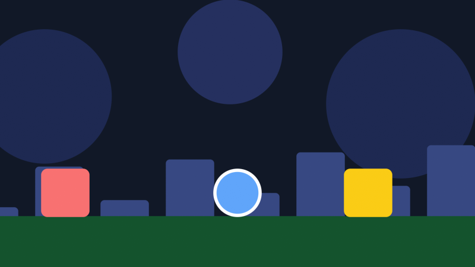

# Depth
This guide will show you how to draw layers with parallax and how the camera's depth works.

The world is flat, but the camera sits above it. By default, the camera is at `Z = 1` and the ground is at a depth of 0. `GetView(z)` gives you the view of a layer at any other depth. `View` is the same as `GetView(0)`.

A layer below the ground has a negative depth. It's farther from the camera, so it looks smaller and moves slower when the camera moves. That's parallax. A layer above the ground looks bigger and moves faster.

## Parallax

Draw the layers from the farthest to the closest:

```csharp
_camera.SetViewport();

_spriteBatch.Begin(transformMatrix: _camera.GetView(-3));
// Draw the sky.
_spriteBatch.End();

_spriteBatch.Begin(transformMatrix: _camera.GetView(-1));
// Draw the buildings.
_spriteBatch.End();

_spriteBatch.Begin(transformMatrix: _camera.View);
// Draw the ground and the player.
_spriteBatch.End();

_camera.ResetViewport();
```

Here's the camera at `X = 0`, then at `X = 300`. The ground moved 300 pixels, the buildings at -1 moved 150 and the sky at -3 moved 75:




A layer's scale is `FocalLength / (Z - z)`. With the defaults, the layer at -1 is at `1 / (1 - -1)`, which is half size. The sky at -3 is at a quarter.

Each layer has its own world coordinates. Pass the layer's depth to `ScreenToWorld`, `WorldToScreen`, `GetViewRect` and `GetBoundingFrustum` to work with it:

```csharp
Vector2 mouseOnBuildings = _camera.ScreenToWorld(mouse.X, mouse.Y, -1f);
RectangleF buildingsView = _camera.GetViewRect(-1f);
```

## Parallax zooming

Moving the camera on the Z axis zooms with parallax. The layers that are closer to the camera grow and shrink faster than the ones that are far:

```csharp
_camera.Z = 2f;
```

At `Z = 2`, the ground is at half size and the layer at -1 is at a third. `Scale` is different. It zooms every layer by the same amount.

`ScaleToZ` gives you the `Z` that draws a layer at a given scale. This puts the ground at twice its size:

```csharp
_camera.Z = _camera.ScaleToZ(2f, 0f);
```

`ZToScale` is the other way around. `_camera.ZToScale(_camera.Z, -1f)` is the scale of the layer at -1.

## Focal length

`FocalLength` is how far a layer is from the camera when it's drawn at a scale of 1. The defaults put the camera at `Z = 1` with a focal length of 1, which is why the ground is at its normal size.

If you raise both by the same amount, the ground keeps its size while the layers behind it get closer to it in size. That makes the parallax weaker:

```csharp
_camera.FocalLength = 3f;
_camera.Z = 3f;
```

The layer at -1 is now at `3 / (3 - -1)`, which is 0.75 instead of 0.5. The focal length can't go below 0.01.

## Layers behind the camera

A layer at the camera's depth or above it is behind the camera. Its view matrix is flipped or broken, so don't draw it. `IsZVisible(z)` tells you whether a layer is at least 0.1 in front of the camera:

```csharp
if (_camera.IsZVisible(0.5f)) {
    _spriteBatch.Begin(transformMatrix: _camera.GetView(0.5f));
    // Draw the clouds.
    _spriteBatch.End();
}
```

You can pass a different minimum distance as the second parameter.

## Follow up

[3D](../3d/README.md), a guide that shows how to draw 3D geometry that lines up with the layers.
