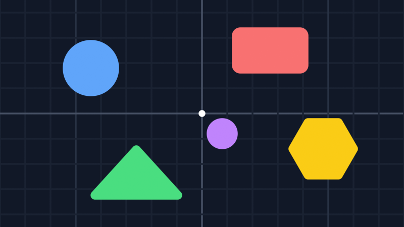

# Getting started
This guide will show you how to get started with the Apos.Camera library.

Before you start, make sure that you have a valid MonoGame project. You can create a new project by following this [other guide](https://learn-monogame.github.io/how-to/get-started/).

## Install

Install using the following dotnet command:

```
dotnet add package Apos.Camera
```

For [KNI](https://github.com/kniengine/kni), use `Apos.Camera.KNI` instead.

The library depends on MonoGame.Extended for `RectangleF`, which needs MonoGame 3.8.4 or later.

## Setup

Import the library with:

```csharp
using Apos.Camera;
```

In your game's `LoadContent()`, create a viewport and give it to a camera. A `DefaultViewport` covers the whole window:

```csharp
protected override void LoadContent() {
    _spriteBatch = new SpriteBatch(GraphicsDevice);

    _viewport = new DefaultViewport(GraphicsDevice, Window);
    _camera = new Camera(_viewport);
}

SpriteBatch _spriteBatch;
IVirtualViewport _viewport;
Camera _camera;
```

The viewport listens to the window so that it follows its size. Dispose it once you're done with it:

```csharp
protected override void UnloadContent() {
    _viewport.Dispose();
}
```

## Drawing

In your game's draw loop, set the viewport, then give the camera's view matrix to the `SpriteBatch`:

```csharp
protected override void Draw(GameTime gameTime) {
    GraphicsDevice.Clear(Color.Black);

    _camera.SetViewport();
    _spriteBatch.Begin(transformMatrix: _camera.View);

    // Your draw code.

    _spriteBatch.End();
    _camera.ResetViewport();

    base.Draw(gameTime);
}
```

`SetViewport` puts the viewport on the `GraphicsDevice` and `ResetViewport` puts back the one that was there before.

Anything that takes a view matrix works the same way. With [Apos.Shapes](https://apostolique.github.io/Apos.Shapes/), it's `_sb.Begin(_camera.View)`.

With the default settings, the camera looks at `(0, 0)` and one world unit is one pixel. The white dot is `(0, 0)`, in the middle of the window:



## Moving the camera

`XY` is the point the camera looks at. It's always in the middle of the viewport. `Scale` zooms in and out, and `Rotation` turns the view around `XY`. The angle is in radians.

```csharp
_camera.XY = new Vector2(100, 50);
_camera.Scale = new Vector2(2f, 2f);
_camera.Rotation = MathHelper.PiOver4;
```


At a scale of 2, everything is twice as big. A positive rotation turns the world clockwise on the screen.

## Follow up

[Camera](../camera/README.md), a guide that shows how to go between screen and world coordinates and how to find what the camera sees.
