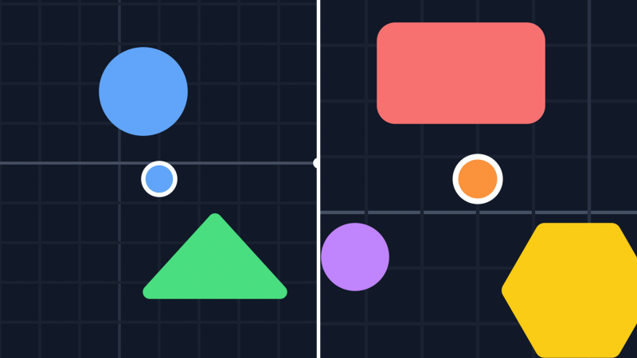
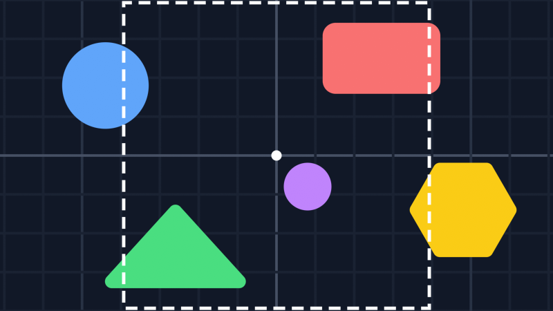
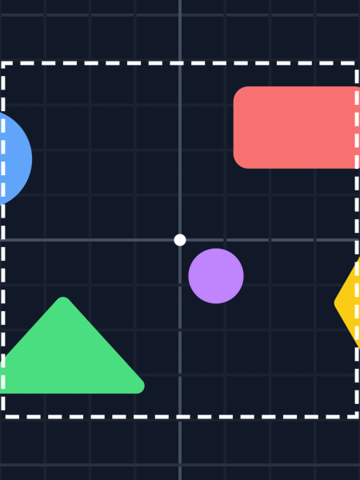

# Viewports
This guide will show you how to split the screen and how to keep the same area visible at any window size.

A viewport is the part of the window that a camera draws to. Every camera takes one:

```csharp
_camera = new Camera(new DefaultViewport(GraphicsDevice, Window));
```

`SetViewport` puts it on the `GraphicsDevice`. While it's set, the `SpriteBatch` draws relative to the viewport's top left corner and anything outside of it gets cut off. `ResetViewport` puts back the viewport that was there before.

The viewports follow the size of the back buffer, so they adjust when the window gets resized or when you change the resolution with `ApplyChanges()`. They listen to the window and the `GraphicsDevice` to do that, so dispose a viewport once you're done with it.

## DefaultViewport

Covers the whole window.

```csharp
IVirtualViewport viewport = new DefaultViewport(GraphicsDevice, Window);
```

## SplitViewport

Covers part of the window. The last four parameters are its left, top, right and bottom edges, as fractions of the window's size from 0 to 1. This makes two viewports side by side, one per player:

```csharp
_left = new SplitViewport(GraphicsDevice, Window, 0f, 0f, 0.5f, 1f);
_right = new SplitViewport(GraphicsDevice, Window, 0.5f, 0f, 1f, 1f);

_camera1 = new Camera(_left);
_camera2 = new Camera(_right);
```

Draw the world once for each camera:

```csharp
protected override void Draw(GameTime gameTime) {
    GraphicsDevice.Clear(Color.Black);

    DrawWorld(_camera1);
    DrawWorld(_camera2);

    base.Draw(gameTime);
}

private void DrawWorld(Camera camera) {
    camera.SetViewport();
    _spriteBatch.Begin(transformMatrix: camera.View);

    // Draw the world.

    _spriteBatch.End();
    camera.ResetViewport();
}
```

Each camera has its own position and zoom. The left player is at normal size while the right one is zoomed in:



Viewports that share an edge always meet without a gap, at any window size.

## DensityViewport

Keeps an area of the world visible at any window size. The last two parameters are the width and height of that area:

```csharp
IVirtualViewport viewport = new DensityViewport(GraphicsDevice, Window, 400, 400);
```

The view gets scaled so that the whole area fits in the window. When the window's shape doesn't match the area's, you see more of the world on the long side instead of black bars. The dashed square is the 400 by 400 area, in a wide window and in a tall one:




`VirtualWidth` and `VirtualHeight` are how much of the world fits in the window at a scale of 1. In the wide window above, that's about 711 by 400. `Ratio` is how many pixels a world unit takes. You can change the area with `TargetWidth` and `TargetHeight`.

The density viewport always covers the whole window.

## Your own viewport

You can make your own viewport by implementing `IVirtualViewport`:

- `X`, `Y`, `Width` and `Height` are where it goes on the back buffer, in pixels.
- `VirtualWidth` and `VirtualHeight` are its size in world units at a scale of 1.
- `Origin` is where the camera's `XY` ends up, in those same units. The built-in viewports put it in the middle.
- `Transform` takes the camera's view and returns it with your scaling added, if you have any.
- `Set` and `Reset` put your viewport on the `GraphicsDevice` and take it off.

## Follow up

[Depth](../depth/README.md), a guide that shows how to draw layers with parallax.
